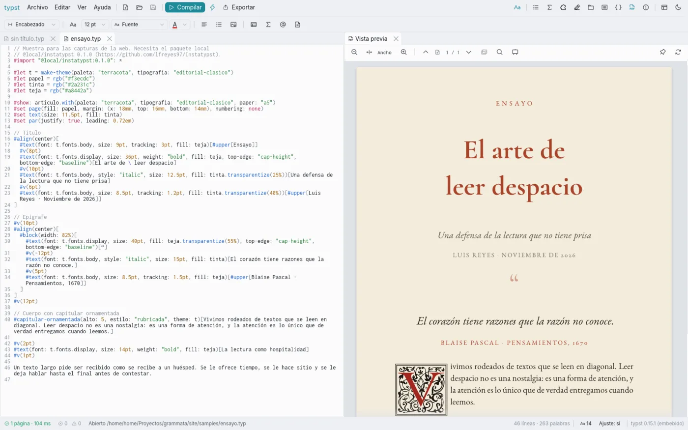
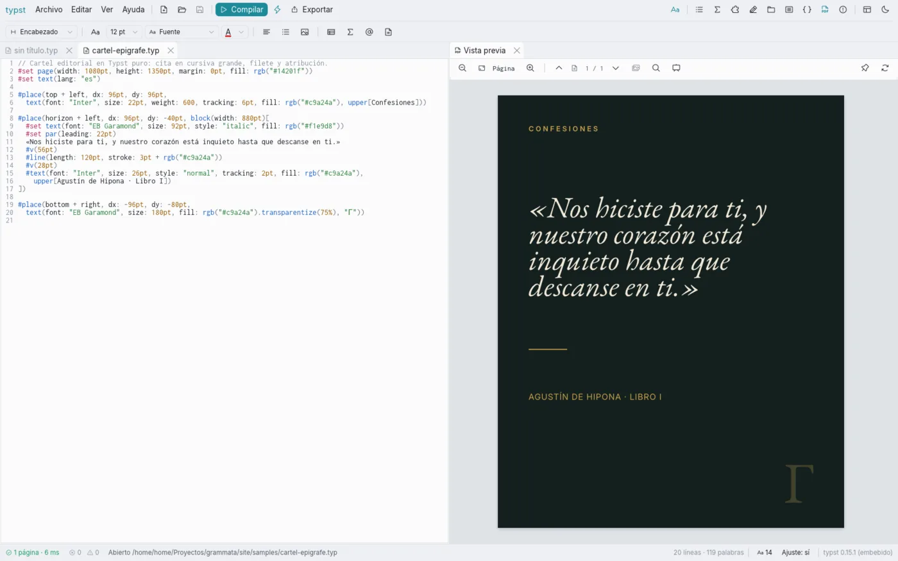
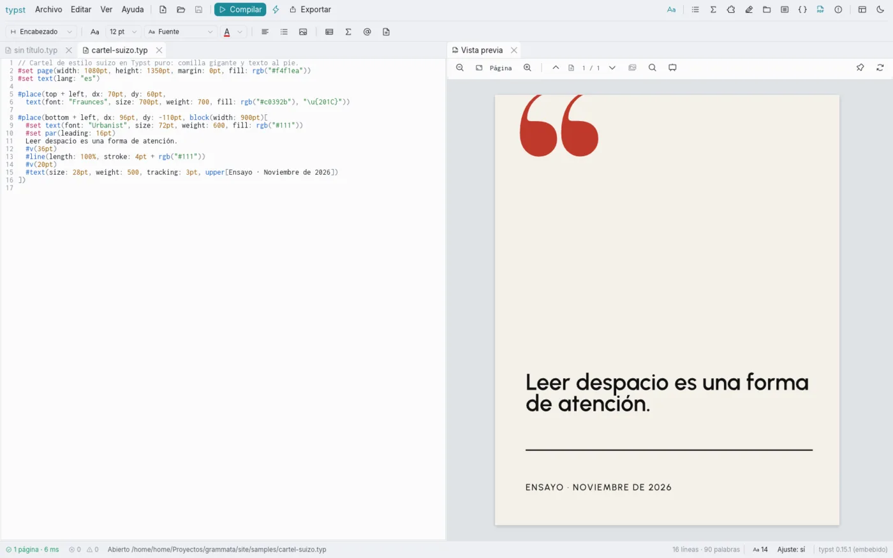
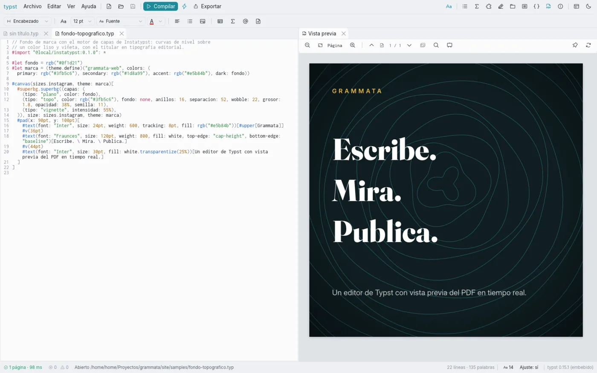

<p align="center">
  <picture>
    <source media="(prefers-color-scheme: dark)" srcset="assets/logo-horizontal-oscuro.svg">
    
  </picture>
</p>

# Grammata — a Typst editor in Rust + egui

**English** · [Español](README.es.md) · [Website](https://lfreyes97.github.io/grammata/)

Grammata is a native desktop editor for [Typst](https://typst.app), written in Rust with
egui: tabs, dockable panels, autocompletion, plugins and a live preview of the **real PDF**.

> **Status:** tested on Linux. macOS has not been tested, and Windows is only built in CI,
> with no manual testing.

## Screenshots

Sample documents (in [`site/samples`](site/samples)), shown with the light or dark theme
depending on your settings. Regenerate the screenshots with `site/capturas.sh`.

<table>
  <tr>
    <td width="50%">
    <picture>
      <source media="(prefers-color-scheme: dark)" srcset="site/img/ensayo-oscuro.webp">
      
    </picture>
    </td>
    <td width="50%">
    <picture>
      <source media="(prefers-color-scheme: dark)" srcset="site/img/cartel-epigrafe-oscuro.webp">
      
    </picture>
    </td>
  </tr>
  <tr>
    <td width="50%">
    <picture>
      <source media="(prefers-color-scheme: dark)" srcset="site/img/cartel-suizo-oscuro.webp">
      
    </picture>
    </td>
    <td width="50%">
    <picture>
      <source media="(prefers-color-scheme: dark)" srcset="site/img/fondo-topografico-oscuro.webp">
      
    </picture>
    </td>
  </tr>
</table>

## Usage

```bash
cd grammata
cargo run
```

Once installed, `grammata file.typ folder/ other.typ` opens the files as tabs
and the folder in the file panel (`--help` and `--version` work as usual).

No external dependencies: the Typst 0.15.1 compiler is embedded
(the CLI doesn't need to be on your `PATH`).

Shortcuts: `Ctrl+N` new, `Ctrl+O` open (or drag a `.typ` in), `Ctrl+S` / `Ctrl+Shift+S`
save, `Ctrl+W` close, `Ctrl+Tab` / `Ctrl+PageUp/PageDown` / `Ctrl+1..9` switch tabs,
`F5` compile, `Ctrl+E` export PDF, `Ctrl+F` find (`Enter`/`F3` next,
`Shift+Enter`/`Shift+F3` previous), `Ctrl+G` go to line, `Ctrl+Space` complete
(`Tab`/`Enter` accepts), `Ctrl+= / - / 0` font size, `Alt+Z` line wrap,
`Ctrl+Shift+O / V / M` outline · preview · problems, `Ctrl+Shift+Y / I / T / F / B` symbols ·
snippets · templates · files · scratchpad, `Ctrl+wheel` zooms the PDF.

Session (tabs, preferences and dock layout) in
`~/.config/grammata/session.json`. Sessions from the previous format migrate on their own.

## What it does

- **PDF preview**: the embedded compiler (`engine.rs`: the `typst` / `typst-pdf` 0.15.1
  crates, no CLI) compiles the live buffer to PDF on a separate thread (`--root` = the file
  manager's folder if it contains the document, otherwise the document's folder, so relative
  `#image`/`#include` and `@preview` packages work) and
  [`hayro`](https://crates.io/crates/hayro) rasterizes it on another thread. Only the visible
  pages are painted (+1 screen), at the exact resolution of zoom × screen density; while the
  new render arrives, the previous one is shown scaled (no flicker). Fit to width / full page /
  manual zoom, page navigation, `PageUp/PageDown`. Export PDF copies the preview's PDF if it
  is up to date.
- **Panels**: Outline, Symbols, Snippets, Preview and Problems are `egui_dock` tabs (drag,
  split, close, reopen from the bar or the View menu). Preset layouts: classic, editor +
  preview, wide preview, writing only.
- **Symbols**: 136 symbols (Greek letters, operators, relations, sets and logic, arrows,
  others) and 22 structures (`frac`, `sqrt`, `sum`, `mat`, `cases`…), with search and recents.
  Outside an equation they are inserted as `$…$` with the cursor left inside; inside one, they
  are separated by spaces from neighbouring identifiers. With text selected, the structures
  wrap it (`abs(sel)`).
- **Snippets**: a built-in library (document, text, lists, figures and tables, math,
  calculation with `calc`, code, layout, references) and your own snippets stored in
  `~/.config/grammata/snippets.json` (the + button creates one from the selection).
  Placeholders: `${sel}` selection · `${sel:x}` selection or `x` · `${x}` filler left
  selected so you can type over it · `${}` cursor.
- **Plugins**: folders in `~/.config/grammata/plugins/` with a `plugin.toml`: a Typst package
  with a form, fonts, snippets, themes and external programs (import and export Markdown with
  pandoc, which must be installed). External programs are code that runs on your machine: they
  only run if you allow them in the panel, and the permission is lost if their command line
  changes. The Pandoc plugin uses `--sandbox` and doesn't let raw Typst, HTML or TeX through.
  Format in [`docs/plugins.md`](docs/plugins.md) and architecture in
  [`docs/plugins-arquitectura.md`](docs/plugins-arquitectura.md) (both in Spanish).
- **Templates**: an Article builder in the side panel (title, author, date, language, paper,
  margins, font, numbering, table of contents, abstract) that opens the document in a new tab;
  everything it generates compiles (`Ctrl+Shift+T`).
- **Files**: a manager for a chosen folder (persisted) with a tree (hierarchy guides,
  breadcrumbs, context menu), open, create, rename and delete with confirmation; open tabs
  follow a rename (`Ctrl+Shift+F`).
- **Scratchpad**: a temporary buffer with live preview for building equations (the whole
  snippet library + quick insertion, `$…$` mode) or trying out fragments and charts; it is
  inserted at the cursor and persists in the session (`Ctrl+Shift+B`).
- **Problems**: diagnostics from the embedded compiler with exact locations (errors,
  warnings, hints); a click jumps to the line, also in included files. With errors the last
  valid preview is kept and a banner says so.
- **Editor**: a custom widget (`code_view.rs`) with highlighting from the official
  `typst-syntax` parser (it understands markup, code and math like the compiler does), line
  numbers that work with line wrap, and current-line highlight; `#function` autocompletion in
  a popup next to the cursor (the snippet leaves the `..` slot selected); search with
  highlighted matches; closing with unsaved changes asks for confirmation.
- **Style**: its own light/dark palette (`theme.rs`), Inter + the system monospace font via
  `fc-match`, [Phosphor](https://phosphoricons.com) icons.

## Brand

The logo (a Γ with a text cursor) is made in Typst: `assets/logo.typ`.
`assets/build-logo.sh` regenerates the SVGs and the PNGs in `assets/icons/`; it only uses
fonts embedded in Typst. The name comes from the Greek γράμματα, “letters”.

## Installation

- **Linux (tar.gz):** `packaging/build-linux.sh` builds and produces
  `dist/grammata-<version>-linux-<architecture>.tar.gz`; inside, `./install.sh [PREFIX]`
  (default `~/.local`) installs the `grammata` binary, the icons and the launcher.
- **Nix:** `nix run github:lfreyes97/grammata` or `nix profile install` (see `flake.nix`).
- **From source:** `cargo install --path .`

## License

Grammata is free software under the **GNU GPL v3 or later** (`LICENSE`).
It uses Typst (Apache-2.0) and other dependencies with compatible licenses.
“Typst” is a trademark of Typst GmbH; this project is independent and not
affiliated with that company.

## Structure

| File | What it contains |
|---|---|
| `main.rs` | eframe startup |
| `app.rs` | state (`State`), per-frame loop, shortcuts and `Action` execution, the dock viewer |
| `actions.rs` | `Action`: what menus, bars, shortcuts and panels can request |
| `chrome.rs` | top bar, status bar and dialogs |
| `editor.rs` | document tab, autocompletion, search bar |
| `code_view.rs` | editing widget: `TextEdit` + line numbers + cached highlighting |
| `highlight.rs` | highlighting and equation detection with `typst-syntax` |
| `preview.rs` | virtualized PDF canvas, zoom, navigation |
| `pdf_render.rs` | rasterizing thread with `hayro` |
| `compile.rs` | compile thread (buffer → in-process PDF) |
| `diagnostics.rs` | compiler diagnostics (spans → line/column) |
| `engine.rs` | embedded Typst `World`: files, packages, fonts, PDF/PNG/SVG |
| `panels.rs` | Outline and Problems panels |
| `symbols.rs` | symbols panel (table validated against Typst) |
| `plugins.rs` | plugins: manifest, templates with a form, panel (`plugins/panel.rs`), external programs (`plugins/run.rs`) |
| `snippets.rs` | snippets panel, `${…}` placeholders, user snippets |
| `templates.rs` | template builders (Article): options → a `.typ` that compiles |
| `files.rs` | file manager: tree, open, create, rename, delete |
| `scratch.rs` | scratchpad with live preview and insertion into the document |
| `layout.rs` | dock tabs, panels, preset layouts |
| `session.rs` | persistent session |
| `theme.rs` | palette, egui/dock/editor styles, fonts |
| `widgets.rs` | reusable buttons and icons |
| `doc.rs`, `text.rs`, `outline.rs`, `syntax.rs` | documents, text utilities, outline, autocompletion snippets |

## Tests

```bash
cargo test                      # unit tests
cargo test -- --include-ignored # + UI walkthrough with egui_kittest (needs typst and a GPU)
                                #   and compilation of every symbol, structure and snippet
SHOT_DIR=/tmp/capturas cargo test -- --include-ignored   # saves a screenshot of each step
```

> Font note: Inter and Adwaita Sans have glyphs in the Private Use Area, the same one
> Phosphor uses. `theme::icons_only` turns off Phosphor's letters in its `cmap` so it can
> be placed in front without eating the text.
